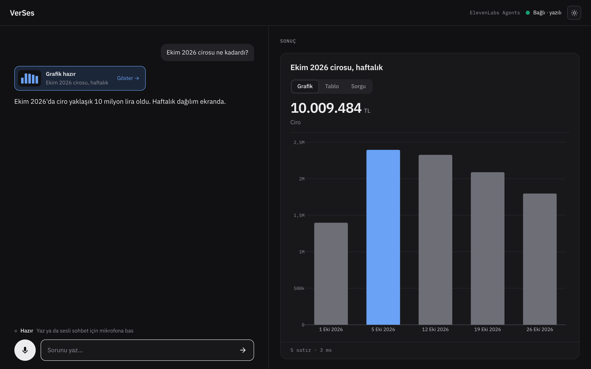
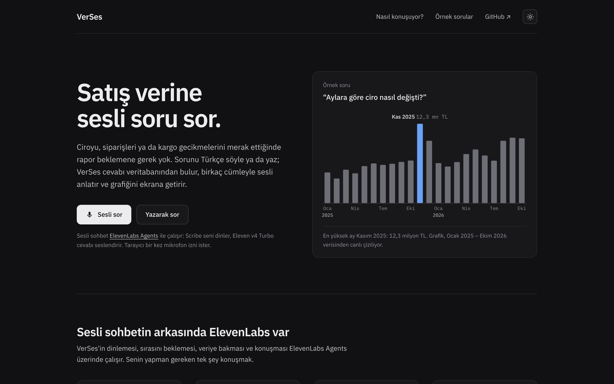
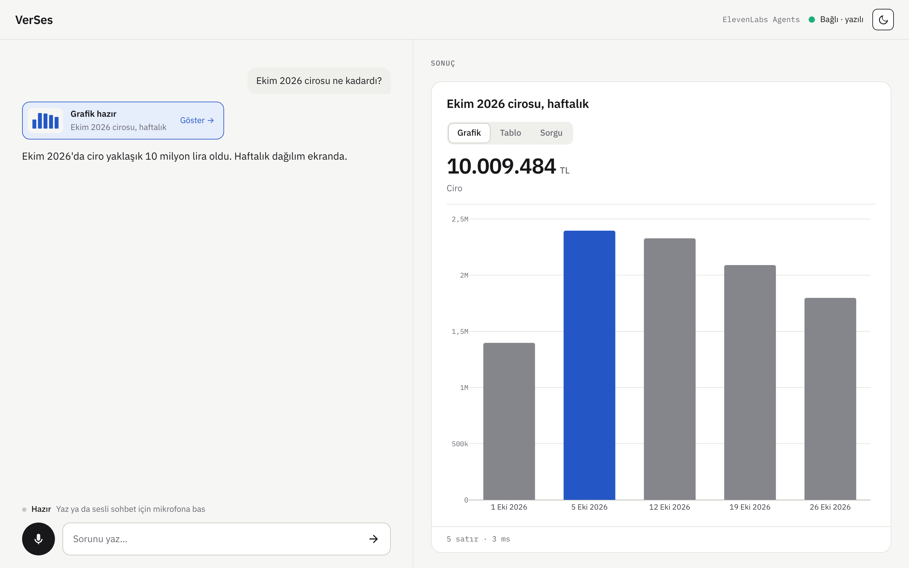

# VerSes: satış verine sesli soru sor

VerSes, Türkçe konuşan bir veri analisti. Satış verisiyle ilgili sorunu söylersin ya da yazarsın. Cevabı veritabanından bulur, birkaç cümleyle sesli anlatır ve grafiğini ekranda açar.

> Örnek: "Haziranda satışlar neden düştü?"
> "Düşüş büyük ölçüde Elektronik'ten geliyor; mayısa göre yaklaşık yüzde 40 geriledi. Kategorilerin seyri ekranda."

Ses tarafı tamamen [ElevenLabs Agents](https://elevenlabs.io/agents) üzerinde çalışır. Veri tarafı FastAPI, SQLite ve Plotly kullanır.



## Ekran görüntüleri

| Giriş sayfası | Analiz ekranı (açık tema) |
|---|---|
|  |  |

- **Giriş sayfası:** Aylık ciro grafiği, veritabanından canlı çizilir. Örnek sorulara tıklayınca VerSes hemen cevaplar.
- **Analiz ekranı:** Solda sohbet, sağda sonuç paneli. Her cevabın grafiği, tablosu ve çalışan SQL sorgusu ayrı sekmelerde görünür. Önceki sonuçlara üstteki listeden dönülebilir.
- **Tema:** Site koyu temayla açılır. Sağ üstteki düğmeyle açık temaya geçilir; seçim tarayıcıda hatırlanır ve grafikler yeni renklerle yeniden çizilir.

## Demo

<!-- Demo videosu buraya eklenecek. -->
Demo videosu yakında eklenecek.

## Nasıl çalışıyor?

```
Mikrofon ──► ElevenLabs Agent ──────────────────────────► Ses (Eleven v4 Turbo)
             │  Scribe Realtime: konuşmayı yazıya döker
             │  LLM: soruyu yorumlar, araç seçer
             ▼
        Client tools (tarayıcıda çalışır)
             │  get_schema · run_query · analyze_trend · show_chart
             ▼
        FastAPI ──► SQLite (salt-okunur)        Plotly grafiği ◄── show_chart
```

- **Client tools:** Ajanın araçları tarayıcıda "client tool" olarak tanımlı. Tarayıcı, aynı makinedeki FastAPI uç noktalarını çağırır ve sonucu ajana iletir. Bu sayede yerel geliştirmede tünel ya da açık bir sunucu gerekmez.
- **get_schema:** Tabloları, kolon notlarını ve kategorik değerleri (şehirler, kategoriler) verir.
- **run_query:** Ajanın yazdığı SQL'i çalıştırır ve grafik türü önerir.
- **analyze_trend:** İki dönemi karşılaştırır, değişimi en çok açıklayan kategori, şehir, ödeme türü, kargo firması ya da markayı bulur. SQL'i sabit şablonlardan üretilir.
- **show_chart:** Son sonucu sağ paneldeki grafik, tablo ve sorgu görünümlerinde açar.

### SQL güvenliği

Ajanın yazdığı SQL üç katmanda korunur (`backend/sql_guard.py`):

1. **Statik kontrol (sqlglot):** Yalnızca tek bir `SELECT` / `WITH ... SELECT` ifadesine izin verilir. Yazma işlemleri, `PRAGMA`, `ATTACH` ve tehlikeli fonksiyonlar reddedilir.
2. **Bağlantı:** SQLite salt-okunur modda açılır. Ayrıca bir authorizer, okuma dışındaki her işlemi reddeder.
3. **Kaynak sınırı:** Sonuç en fazla 500 satırla sınırlanır, 5 saniyeyi aşan sorgu kesilir.

Hatalı sorguda araç okunur bir hata mesajı döner, ajan da sorgusunu düzeltip tekrar dener.

## Veri seti

Sentetik bir Türk e-ticaret veri seti: Ocak 2025 – Ekim 2026, yaklaşık 30 bin sipariş, 5 bin müşteri, 300 ürün, 8 kategori ve 20 şehir. İçine değerlendirme için üç olay gömülü: Black Friday haftası, Mart 2026'daki İzmir kargo krizi ve Haziran–Temmuz 2026'daki Elektronik düşüşü. Ayrıntılar [data/VERI_SETI.md](data/VERI_SETI.md) dosyasında.

Veritabanı depoda yer almaz; tek komutla, her seferinde aynı veriyle üretilir.

## Kurulum

Python 3.10 veya üstü gerekir.

```bash
pip install -r requirements.txt
python data/generate_data.py          # data/voicebi.db
cp .env.example .env                  # Windows: copy .env.example .env
```

`.env` içinde `ELEVENLABS_AGENT_ID` ajanın kimliğidir. Ajanda kimlik doğrulama açıksa `ELEVENLABS_API_KEY` de gerekir. Anahtar tarayıcıya gönderilmez; sunucu yalnızca kısa ömürlü imzalı bir bağlantı adresi verir.

## Çalıştırma

```bash
uvicorn backend.app:app --port 8765
```

Ardından tarayıcıda `http://localhost:8765` adresini aç. "Sesli sor" ile konuşabilir, "Yazarak sor" ile yazabilirsin.

Ajanın sistem talimatı `agent/prompt.md`, ayarları `agent/config.json` dosyasında.

## Testler

```bash
python -m pytest -q
```

Testler SQL güvenliğini, araçları, gömülü olayların bulunmasını ve değerlendirme puanlamasını kapsar.

## Değerlendirme

`eval/questions.json` içinde doğru cevabı veritabanından hesaplanan 25 soru var. Betik her soruyu ajana yazılı olarak sorar, araç çağrılarını yerelde çalıştırır ve cevaptaki sayıyı ya da ifadeyi doğru cevapla karşılaştırır. Sesli cevaplar yuvarlandığı için ("yaklaşık 2,4 milyon") sayılar toleransla karşılaştırılır.

```bash
python -m eval.run_eval              # tüm sorular
python -m eval.run_eval --ids 4 15   # belirli sorular
```

Sonuçlar `eval/SONUCLAR.md` dosyasına yazılır.

### Sonuçlar

<!-- Tam değerlendirme çalıştırılınca doğruluk oranı ve medyan cevap süresi buraya yazılacak. -->
Tam değerlendirme sonuçları yakında eklenecek.

## Proje yapısı

```
agent/      ElevenLabs ajanının talimatı ve ayarları
backend/    FastAPI, araçlar, SQL güvenliği, grafik önerisi
data/       Veri üreteci ve veri seti açıklaması
docs/       README ekran görüntüleri
eval/       Değerlendirme soruları, betiği ve puanlama
frontend/   Arayüz (HTML, CSS, JS); Plotly, ElevenLabs istemcisi ve fontlar vendor/ içinde
tests/      pytest testleri
```

## Lisans notları

`frontend/vendor` içindeki Plotly ve ElevenLabs istemcisi MIT, IBM Plex fontları SIL Open Font License ile dağıtılır. Lisans metinleri aynı klasörde.

Veriler gerçek değildir; bu proje bir portföy çalışmasıdır.
